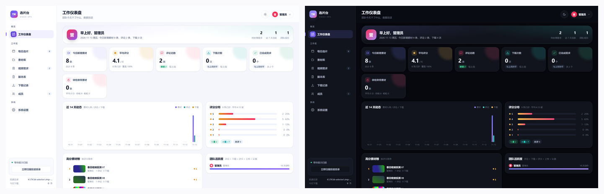
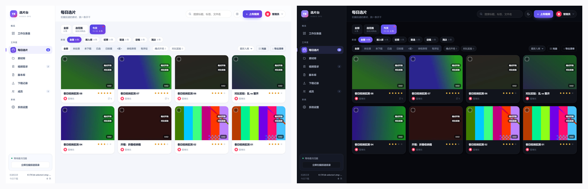
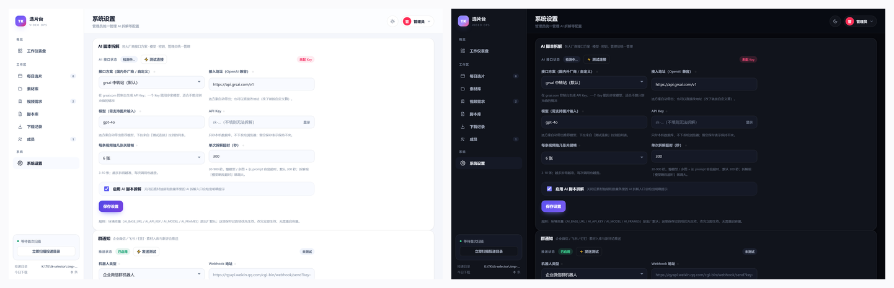
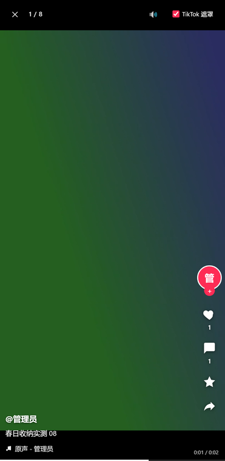

# 选片台 · TK 产品视频工作台

给 TikTok 内容团队用的视频选片 / 素材管理 / 需求协作工具。跑在本地 NAS 上，Docker 单容器部署，数据不出内网。

## 界面预览

浅色 / 深色两套主题，右上角一键切换（跟随浏览器记住选择）。左浅色、右深色：







手机端点素材卡片进入 **TikTok 式竖滑播放器**，上下滑动刷片，可勾选「TikTok 遮罩」预览成品在原生界面里的观感：




## 解决什么问题

拍摄每天拍回来一堆素材，运营散在群里问「这条能不能用」——选片台把这条链路固化下来：

| 环节     | 以前            | 现在                                                |
| ------ | ------------- | ------------------------------------------------- |
| 拍摄交付   | 微信/网盘发一堆文件    | 丢进 NAS 共享文件夹，自动入库并按拍摄日期分好                         |
| 运营找素材  | 翻聊天记录、下载到本地再看 | 网页里按日期浏览，卡片/列表切换，直接在线播放                           |
| 谁拿了哪条  | 无记录，重复要片      | 每次下载自动记人，卡片上直接显示「最近谁下过」                           |
| 好不好用   | 全靠嘴说          | 1-5 星评分，可按「已标星」「4 星+」筛，按评分排序                      |
| 反馈     | 群里打字，找不到上下文   | 每条素材下独立评论区                                        |
| 通用素材沉淀 | 过几天就找不到       | 素材库，所有人可上传，打标签检索                                  |
| 运营提需求  | 口头说，容易漏       | 需求板：发布 → 认领 → 交付 → 关联素材                           |
| 找人     | 手动加账号         | 自助注册（名字 + 密码），内置管理员兜底                             |
| 团队进度   | 每周开会问一遍       | **工作仪表盘**：素材、评论、下载、评分、需求完成情况一屏看完                  |
| 复盘爆款   | 人肉逐帧看竞品成片     | **AI 脚本拆解**：抽关键帧交给多模态模型，自动产出钩子 / 分镜表 / 口播稿，沉淀进脚本库 |
| 群里同步    | 手动转发、@来@去     | **群通知**：企业微信 / 飞书 / 钉钉机器人推送素材入库与新评论，评论里 @成员 → 群里真实艾特；配公网地址后钉钉直接发**封面缩略图卡片** |
| 手机上审片  | 相册里一条条点开，看不出成品感 | **TikTok 式竖滑播放器**：上下滑动刷片，一键切换「TikTok 遮罩」预览头像/点赞/收藏/分享/标题的原生界面效果 |

## 快速开始（群晖 DSM 7.x）

### 1. 准备共享文件夹

在 File Station 建两个共享文件夹：

- `选片台数据` — 存数据库和视频文件（**必须**）
- `拍摄投递` — 拍摄每天往里丢视频（可选，也可以只用网页上传）

### 2. 上传代码

把整个 `tk-selector` 目录传到 NAS，例如 `/volume1/docker/tk-selector`。

### 3. 改配置

在 `/volume1/docker/tk-selector/` 下**先手工建一个空的 `data` 文件夹**（群晖不会自动创建挂载点），然后编辑 `docker-compose.yml`：

```yaml
ports:
  - "8899:8080"       # 宿主机端口:容器端口；88 常被群晖系统占用，建议用 8899
environment:
  PUID: "1026"        # 你的群晖账号 UID
  PGID: "100"         # 你的群晖账号 GID
  AI_API_KEY: ""      # 可留空：部署后管理员在「系统设置」界面里填，立即生效
volumes:
  - ./data:/data
  - /volume1/拍摄投递:/watch:ro
```

> UID/GID 查看方式：控制面板 → 用户与群组 → 选中你的账号 → 编辑 → 用户信息。  
> 首个创建的用户一般是 `1026` / `100`。

### 4. 启动

**方式 A：Container Manager（图形界面）**  
Container Manager → 项目 → 新增 → 路径选 `/volume1/docker/tk/tk-selector` → 来源选「创建 docker-compose.yml」粘贴上面的配置 → 下一步 → 完成。

**方式 B：SSH**

```bash
cd /volume1/docker/tk/tk-selector
sudo docker compose up -d --build
```

### 5. 打开

浏览器访问 `http://NAS的IP:8899`（端口按你上面的映射改）。

登录后默认进入**工作仪表盘**：今天新增了多少素材、团队评论与下载情况、评分分布、高分素材榜、成员活跃度、需求状态和最近动态，都集中在这一页，数据直接从业务表统计，改完素材回来就是最新的。

右上角太阳/月亮图标切换**亮色 / 深色主题**（默认跟随系统，手动切换后会记住）。

---

## 账号与说明

系统采用**统一登录入口**，没有「先选身份再进」的步骤：一个页面里切换「登录 / 注册新账号」。

### 内置管理员（首次部署即可用）

| 项目     | 值             |
| ------ | ------------- |
| 账号（名字） | `管理员`         |
| 初始密码   | `tkadmin2026` |
| 角色     | 管理员           |

用途：首次部署后用它登录、添加成员、管理账号与密码、发布需求、审片下载。**登录后请立刻在「右上角头像 → 修改密码」里改掉初始密码。**

密码可用环境变量覆盖：

```yaml
environment:
  ADMIN_NAME: 管理员
  ADMIN_PASSWORD: 换成你自己的初始密码
```

> 升级说明：从旧版本（无密码、选身份进入）升级时，所有历史账号会被统一设置成上面这个初始密码，容器启动日志里会列出被初始化的账号名。

### 注册与新成员

- 自助注册：填名字、选角色（运营 / 拍摄 / 只读）、设置密码（至少 6 位）
- 管理员可在「成员」页直接添加成员并指定初始密码；管理员角色只能由管理员创建
- 任何人都能改自己的密码（需验证当前密码）；管理员可重置他人密码

---

## 怎么用

### 拍摄：把视频交上去

两种方式，随便挑：

1. **丢文件夹**（推荐）：把当天素材复制到 NAS 的 `拍摄投递` 文件夹。系统每 *5 分钟扫一次，自动识别日期（优先从路径里的 `2026-11-11` 这类日期取，取不到就用文件修改时间），生成缩略图、读取时长和分辨率后入库。*
2. ***网页上传****：右上角「上传视频」，可多选、可拖拽。*

*重复素材靠文件内容指纹（大小 + 首尾 1MB 的 MD5）自动去重，同一支片子重复投递只会入库一次。*

### *运营：选片和下载*

- *左侧「每日选片」，默认看今天；上方日期条切换历史素材*
- ***日期范围****：日期条上的「选范围」可按起止日期筛，也可以点「近 7 天 / 近 30 天 / 本月」快捷选*
- *卡片模式看缩略图，列表模式看规格（分辨率 / 时长 / 体积）*
- ***评分****：鼠标移到卡片上，标题右侧出现 5 颗星，点一下即评分，再点同一颗取消。筛选项里有「已标星」「4星+」，排序可选「评分最高」*
- *批量评分：勾选多条 → 底部操作条点「评分」→ 选星级*
- *点卡片打开详情：在线播放、看评论、打标签*
- *勾选多条 → 底部浮出操作条 →&#x20;****打包下载****（自动打 zip，保留原文件名）*
- *下载即记录：谁、什么时候、拿了哪几条，卡片右上角会显示「最近下载人」*

### *素材库*

*「存入素材库」把好用的通用素材从每日池子挪到长期库，所有人可上传、可搜索、可打标签。*

### 手机端竖滑刷片（TikTok 模式）

手机上点任意素材卡片，直接进入**全屏竖滑播放器**：

- **上下滑动**切换上一条 / 下一条（桌面端用滚轮或 ↑↓ 键），循环播放，点击画面暂停，右上可切声音
- **TikTok 遮罩**（右上角勾选，状态会记住）：叠加原生界面效果——右列头像 / 点赞 / 评论 / 收藏 / 分享，左下 @上传者 + 标题 + 原声行，底部进度条。用来快速判断「这条发出去在 TikTok 里是什么观感」
- 遮罩里的按钮不是摆设：**💬 打开真实评论**（可直接发）、**⭐ 标记入选**（真写入选片阶段）、**↗ 复制分享文案**、❤ 显示评论热度
- 桌面端从素材抽屉点「▶ 竖滑模式」也能进同一个播放器
- 关掉遮罩就是一键干净的竖屏预览，适合投屏给客户看

### 播放流畅性（自动生成播放版）

手机拍的原片通常是 **HEVC / H.265（10-bit、1080×1920@60、约 15 Mbps）**，浏览器兼容性很差——安卓 Chrome / 微信内置浏览器基本解不了，桌面 Chrome 多数也不支持，表现就是转圈、卡顿、黑屏。

所以素材入库后会在后台**自动生成一份 H.264 播放版**（720p 内、faststart、约 1-2 Mbps），播放走播放版、**下载仍拿原片**：

- 队列串行执行（一次 1 条），不会把低功耗 NAS 的 CPU 打满；想彻底关掉设 `PROXY_ENABLED=0`
- 首次播放如果播放版还没转好，会先提示「正在生成流畅播放版」并自动重试，转好后秒开
- 已经是 H.264 且码率不高的视频不会重复转码（省 CPU）
- 播放接口支持 Range 分片（206），iOS 起播、拖进度条都正常

### *选片流水线（多轮筛选）*

*素材不是「看过就算了」，而是走一条可度量的流水线（参考电商中台的选品流程）：*

```
新入库 → 初筛 → 复选 → 定稿
                ↘ 淘汰
```

- 选片页顶部有一排阶段胶囊，带实时数量，点一下只看该阶段
- 详情页可一键把素材移到任意阶段；批量操作接口 `POST /api/videos/bulk-stage`
- 仪表盘「选片流水线」面板显示各阶段数量、**通过率**（定稿 / 已评审）和已评分数量

### 内容维度评分

单一 1-5 星信息量太低，所以拆成 5 个维度（各 0-10 分）：

| 维度      | 看什么        |
| ------- | ---------- |
| 前 3 秒钩子 | 开场能不能抓住人   |
| 画面质感    | 构图、光线、清晰度  |
| 卖点清晰    | 产品卖点是否一眼看懂 |
| 节奏      | 信息密度、是否拖沓  |
| 合规口播    | 无极限词、无误导表述 |

拖动滑块即存，**综合分 = 均分 × 10**（0-100），卡片上显示 `内容 82`。仪表盘「内容评分维度」面板给出团队各维度均分 —— 一眼看出是钩子不行还是画面不行。

> 星级（1-5）保留作"整体印象"，维度分用于定位短板，两者互补。接口：`PATCH /api/videos/:id {"scores":{"hook":9,"visual":7,...}}`，分数会合并而不是覆盖，传 0 可清零某维度。

### 投放体检（自动 QC）

每条素材入库后会在后台自动跑一遍体检，**不影响上传速度**（队列每 20 秒处理 2 条）：

| 检查项     | 判定                     | 为什么重要              |
| ------- | ---------------------- | ------------------ |
| 无音轨     | 没有音频流                  | 信息流素材几乎必须有声音       |
| 分辨率偏低   | 短边 < 720               | 竖屏投放会糊             |
| 码率偏低    | 720p+ 但码率 < 900kbps    | 快速运动画面糊成一团         |
| 响度偏离    | < -24 LUFS 或 > -9 LUFS | 平台按 -14 LUFS 左右归一化 |
| 黑边      | 实际画面 < 原尺寸 92%         | 竖屏要裁满，否则浪费展示位      |
| 黑场 / 静止 | 黑帧 > 6% / 静止 > 15%     | 直接影响完播率            |
| 时长异常    | < 3 秒 或 > 3 分钟         | 信息流不适合             |
| 非 H.264 | 编码不是 h264              | 浏览器可能放不了，需要转码      |

综合成 **0-100 体检分**，卡片上出现 `⚠ 原因`，详情页有完整指标和「重新体检」按钮；筛选栏有「体检异常」，批量操作条有「重新体检」。

> **素材库不参与体检**：体检只针对「每日选片」里的投放素材。素材库存的是通用素材 / 参考资料，入库即标记 `skipped`、不进体检队列，详情页也会提示不体检（升级时历史素材库排队项会自动清出队列）。

```bash
# 低功耗 NAS 上可以关掉体检（默认开启）
QC_ENABLED=0
```

> 首次升级到 1.3 时，历史素材会被重新体检一遍（2 条/20 秒），期间 NAS 会有一点 CPU 占用，属正常。

### 重复素材识别（感知哈希）

文件级 MD5 只能识别「同一个文件」，识别不了转码、改分辨率、改名、剪掉片头的版本。所以额外对每条素材按 25%/50%/75% 抽 3 帧，缩到 9×8 灰度算 **dHash**：

- 时长相差在 5%（至少 1 秒）以内才比较
- 至少 2 帧命中、最小汉明距离 ≤ 6 才判定为重复
- 命中的素材在卡片上标「疑似重复」，详情页列出相似素材

实测：把一条视频转成 480×270 / CRF 32 后上传，MD5 完全不同，但被准确识别为同一素材（距离 0）。

### 导出选片清单

- 勾选多条 → 底部操作条「导出清单」
- 或者筛选栏右侧「↓ 导出清单」，按当前筛选（日期 / 标签 / 评分 / 体检异常）导出

CSV 带 BOM，Excel 直接打开不乱码，字段包括：素材 ID、标题、拍摄日期、时长、分辨率、编码、码率、帧率、评分、评论数、下载次数、**体检分**、**体检问题**、疑似重复、上传人、原文件名 —— 直接交接给投放和剪辑。

### 视频需求

运营在「视频需求」里发布需求（标题、描述、优先级、截止日期、标签）。

拍摄点「我来拍」认领 → 状态自动变「进行中」→ 上传交付素材时选「上传交付」，视频自动挂到需求下 → 完成后点「标记完成」。

### AI 脚本拆解（脚本库）

把成片交给 AI，自动逆向拆成可复用的拍摄脚本，沉淀进「脚本库」：

- **拆解超时可调**：默认单次 300 秒（一次要传多张关键帧 + 长 prompt，原来 120 秒对慢模型不够）；「系统设置」里「单次拆解超时」支持 30-900 秒，改完立即生效。若仍报「模型响应超时」，把超时调大，或把抽帧数从 6 降到 4
- **入口**：素材详情抽屉的「✦ AI 拆解」；勾选多条后底部操作条的「✦ AI 拆解」会排队批量处理（并发上限 2，多的真排队）；重复点同一条、或对进行中的任务连点重试，都只复用当前任务，不会重复调用模型
- **流程**：服务端 ffmpeg 按 `AI_FRAMES`（默认 6）均匀抽关键帧 → 以 base64 连同时间码发给多模态模型 → 产出**标题 / 一句话卖点 / 前 3 秒钩子 / 拍摄设定（场景·人物·道具·光线·机位·节奏）/ 分镜卡（时间·画面运镜·具体动作·台词·屏幕字幕·音效·道具·衔接方式）/ 完整口播稿 / 收口 CTA / 标签 / AI 复刻提示词**，全部为中文
- **给 AI 复刻用**：每段分镜的「动作」写清谁、用哪只手、做什么、表情变化；`replicate_prompt` 是一段可直接粘进 Sora / 可灵 / 即梦的复刻提示词（自带画幅、时长、镜头序列与禁忌项）；详情里可整份复制或导出 .txt 交接给拍摄
- **脚本库页面**：卡片按状态分组（已拆解 / 进行中 / 失败），支持关键词搜索（标题、摘要、标签、口播稿全文）
- **详情弹层**：关键帧横滑条（点开看大图）、分镜表、口播稿一键**复制 / 导出 .txt**，失败可一键「重新拆解」，支持 `?script=<id>` 深链分享
- **AI 状态自检**：脚本库右上角「◇ AI 状态」可查看中转站连通性与可用模型，不消耗额度

AI 接入走 OpenAI 兼容协议，默认指向 [grsai.com](https://grsai.com/) 中转站；**只有抽出来的关键帧会以 base64 出内网，视频文件本身不上传**。

**配置入口**：管理员登录后，侧边栏「系统 → 系统设置」里统一管理接口方案 / 接入地址 / 模型 / API Key / 抽帧数 / 启用开关，**保存后立即生效，不用重启容器**。接口方案内置国内外主流厂商预设（grsai 中转站、OpenAI、DeepSeek、阿里通义千问、智谱 GLM、Kimi、火山方舟豆包、Google Gemini、OpenRouter、硅基流动），选中自动带出地址与推荐模型；也支持「自定义」填任意 OpenAI 兼容接口。「⚡ 测试连接」会把连通性、API Key、当前模型各验一遍（真实调用消耗几十个 token）；对不开放模型列表的厂商（如火山方舟）也能正常验证。环境变量只是出厂默认值，界面上保存过的项优先；API Key 只存本机数据库、不下发给浏览器（界面只显示打码后的形态）。普通成员在设置页只读，改设置接口仅限管理员。

**可靠性设计**：

- 模型调用遇到 429 / 5xx / 网络抖动会自动重试一次（2 秒退避）；超时用中文提示，不会卡成「永远拆解中」
- 服务重启时，重启前仍在排队的任务会统一标记为失败并提示「点重新拆解」，不会永远挂在「进行中」
- 关键帧存进每条脚本自己的目录 `frames/s-<脚本id>/`，多条脚本 / 重拆互不覆盖；删除脚本、删除素材都会级联清掉对应帧目录，磁盘不泄漏

### 群通知（企业微信 / 飞书 / 钉钉）

把「有新素材」「有新评论」推到团队群，不用再守着网页刷：

- **配置入口**：管理员登录后「系统 → 系统设置 → 群通知」，选机器人类型（企业微信群机器人 / 飞书自定义机器人 / 钉钉自定义机器人）、填 Webhook 地址，**保存立即生效，不用重启容器**；「⚡ 发送测试」一键验证配置
- **推送事件**（均可单独开关）：
  - **素材入库**：网页上传或 NAS 投递目录扫描到新素材时推送，带上传人、数量、素材标题与时长；去重的重复上传不推送
  - **新评论**：评论发出即推送，带评论人、素材标题与正文
- **@成员真实艾特**：评论里 `@名字`，群消息会按平台语法真实艾特对应成员——企业微信用 `<@userid>`、飞书用 `<at user_id>`、钉钉按手机号（`atMobiles`）。需要先在「成员」页给成员配好**通知账号**（企业微信 userid / 钉钉手机号 / 飞书 user_id）；没配的成员只会以文字出现在消息里
- **安全**：钉钉 / 飞书机器人开了「加签」的，在设置里填加签密钥即可（自动按平台算法签名）；webhook 推送失败只记日志，绝不影响上传和评论本身
- **缩略图卡片（钉钉）**：填好「公网访问地址」后，钉钉的素材入库通知会变成 **feedCard 卡片**——每条素材一张卡，显示封面图缩略图 + 标题 + 时长，点卡片直达视频；最多 8 条。企业微信则把封面图直接内嵌到 markdown 里；飞书 text 机器人不支持图片，仍是文字列表
- **免费拿到公网地址（Cloudflare 快速隧道）**：不用域名、不用注册，群晖上一条命令即可：
  ```bash
  docker run -d --name tk-tunnel --restart unless-stopped --network host \
    cloudflare/cloudflared:latest tunnel --no-autoupdate --protocol http2 --url http://127.0.0.1:8899
  docker logs tk-tunnel 2>&1 | grep -o 'https://[a-z0-9-]*\.trycloudflare\.com' | head -1
  ```
  把打印出来的 `https://xxx.trycloudflare.com` 填进「公网访问地址」即可。快速隧道的域名在容器重启后会变，仓库里 `deploy/update-public-base.sh` 会从隧道日志里取最新地址并自动写回设置（可挂到群晖「任务计划」里开机跑一次）。
- **公网地址怎么填**：钉钉 / 企微客户端要自己从公网拉图，NAS 内网地址（192.168.x.x）它们打不开。所以需要给工作台一个公网可达的地址：DDNS 域名、反向代理（Nginx / 群晖反代）、内网穿透（frp / cloudflared）任一种都行，填到「公网访问地址」即可。不填 = 只发文字列表（旧行为），不影响推送本身
- 环境变量 `NOTIFY_*` 是出厂默认，界面保存过的项优先

---

## 在线升级（从 GitHub 拉新版）

代码托管在 GitHub，升级有两条路，按你的网络与习惯选一条。

### 方式 A：只换源码，不重新构建（推荐）

前提：容器把源码目录挂载进来（见 `docker-compose.source.yml`）。在项目 YAML 的 `volumes` 里加两行：

```yaml
    volumes:
      - ./data:/data
      - /volume1/拍摄投递:/watch:ro
      - ./server:/app/server
      - ./public:/app/public
      - ./package.json:/app/package.json:ro
```

> 最后一行只读挂载 `package.json`，是为了让 `/api/version` 显示的版本号与磁盘文件一致（否则它读的是镜像里的旧版本号，容易误判升级是否成功）。

保存 → 重新部署（只重建容器，十几秒，**不构建镜像**）。之后每次升级只需：

```
# 群晖「任务计划」，用户选 root
curl -fsSL https://raw.githubusercontent.com/wengadajie/tk-selector/main/scripts/nas-upgrade.sh -o /tmp/up.sh && sh /tmp/up.sh
```

脚本会：备份 `public`/`server` → 从 GitHub 下载最新源码 → 覆盖（不动 `data`）→ 重启容器 → 打印当前版本。整个过程十几秒。

### 方式 B：用 CI 构建好的镜像（推荐，不用在本机构建）

仓库里的 GitHub Actions 会在每次 push 后自动构建镜像并推到 GHCR（`ghcr.io/wengdajie/tk-selector`，linux/amd64，公开镜像**拉取无需登录**）。

**首次安装（群晖 Container Manager）**：

1. 在 File Station 建项目目录（如 `/volume1/docker/tk-selector`），在里面建空 `data` 文件夹
2. Container Manager → 项目 → 新增 → 选择「创建 docker-compose.yml」，粘贴仓库里 `deploy/docker-compose.ghcr.yml` 的内容（按需改端口、PUID/PGID、拍摄投递目录）
3. 下一步 → 完成，首次会自动 `docker pull`

**日常更新**：把 `deploy/update.sh` 放到同一个目录，SSH 执行一次即可：

```bash
sh update.sh          # 拉最新镜像 → 重建容器 → 清旧镜像 → 打印当前版本
```

等价于 `docker compose pull && docker compose up -d`；Container Manager 里也可以点「操作 → 拉取镜像并重启」。

**要固定某个版本**：把 image 改成带版本号的标签，例如 `ghcr.io/wengdajie/tk-selector:v1.7.0`（每次发版都会同时打 `latest` 和 `vX.Y.Z`）。

### 怎么确认升级成功

访问 `http://NAS的IP:端口/api/version`，返回的 `version` 与 `frontendBuiltAt` 就是当前镜像里真实生效的代码版本。

## 数据与备份

所有状态都在 `data/` 目录：

```
data/
├── app.db                  SQLite（成员、素材元数据、评论、下载记录、需求）
├── app.db-wal / app.db-shm
├── media/
│   ├── daily/2026-11-11/   每日素材（文件名是 UUID，原始名存在库里）
│   ├── library/            素材库
│   ├── thumbs/             缩略图（可删，会重新生成）
│   └── frames/s-<脚本id>/   AI 拆解抽出的关键帧（每条脚本独立目录；删脚本/删素材自动级联清理）
└── watch/                  本地开发用的投递目录（Docker 里用挂载的 /watch）
```

**备份**：整个 `data/` 目录打包即可（建议停容器后备份，或用群晖 Hyper Backup 做快照）。

**注意**：数据库是唯一事实来源。手动在 `media/` 里挪文件会导致记录失效，请在网页里操作。

## 环境变量

| 变量               | 默认                         | 说明                                              |
| ---------------- | -------------------------- | ----------------------------------------------- |
| `PORT`           | 8080                       | 监听端口                                            |
| `DATA_DIR`       | `/data`                    | 数据根目录                                           |
| `MEDIA_DIR`      | `/data/media`              | 视频文件目录                                          |
| `SCAN_DIR`       | `/watch`                   | 拍摄投递扫描目录                                        |
| `SCAN_MODE`      | `copy`                     | `copy` 复制入库（投递目录保留原件）/ `move` 移动入库（省空间）/ `link` |
| `SCAN_INTERVAL`  | 300                        | 扫描间隔秒数，`0` 关闭定时扫描                               |
| `SCAN_IGNORE`    | `@eaDir,#recycle,...`      | 扫描跳过的目录名（群晖系统目录已内置）                             |
| `ADMIN_NAME`     | 管理员                        | 内置管理员账号名（首次启动创建；已有管理员则只补密码）                     |
| `ADMIN_PASSWORD` | tkadmin2026                | 内置管理员初始密码，也是历史无密码账号的初始化密码                       |
| `ACCESS_CODE`    | 空                          | 设置后新增/删除成员需输入口令                                 |
| `MAX_UPLOAD_MB`  | 4096                       | 单文件上传上限                                         |
| `QC_ENABLED`     | 1                          | 投放体检后台队列开关，`0` 关闭（低功耗 NAS 想省 CPU 时可关）           |
| `AI_ENABLED`     | 1                          | AI 脚本拆解开关（出厂默认；管理员可在「系统设置」里改，界面值优先）              |
| `AI_BASE_URL`    | <https://api.grsai.com/v1> | OpenAI 兼容中转站地址（结尾不带 `/`）                        |
| `AI_API_KEY`     | 空                          | 中转站密钥的出厂默认；**建议直接在「系统设置」界面里填**（界面值优先、立即生效）        |
| `AI_MODEL`       | gpt-4o                     | 多模态模型名，需支持图片输入（如 `gpt-4o`、`gemini-2.5-flash` 等） |
| `AI_FRAMES`      | 6                          | 每条视频抽几张关键帧（3-10，越多越准也越贵）                        |
| `AI_TIMEOUT_MS`  | 300000                     | 单次模型调用超时（慢模型可调大；界面里有「单次拆解超时」）                  |
| `NOTIFY_ENABLED` | 1                          | 群通知总开关（出厂默认；管理员可在「系统设置」里改，界面值优先）                |
| `NOTIFY_TYPE`    | wecom                      | 机器人类型：`wecom` / `feishu` / `dingtalk`           |
| `NOTIFY_URL`     | 空                          | 群机器人 Webhook 地址（建议直接在「系统设置」界面里填）                |
| `NOTIFY_PUBLIC_BASE` | 空                     | 公网访问地址（如 `https://tk.example.com`）：钉钉缩略图卡片、企微内嵌图片需要 |
| `NOTIFY_SECRET`  | 空                          | 钉钉 / 飞书「加签」密钥，企业微信机器人留空                         |
| `NOTIFY_ON_UPLOAD` | 1                        | 素材入库推送开关                                        |
| `NOTIFY_ON_COMMENT` | 1                       | 新评论推送开关                                         |
| `TZ`             | Asia/Shanghai              | 时区，影响「今天」的判定                                    |

## 本地开发

```bash
npm install
npm start          # http://127.0.0.1:8080
```

需要本机有 `ffmpeg` / `ffprobe`（用于抽帧和读元数据）。Windows 上可以用 `winget install ffmpeg`。

造一批演示数据：

```bash
node scripts/seed-demo.mjs       # 3 条需求 + 认领 + 评论 + 下载记录
node scripts/smoke.mjs           # 38 项接口冒烟测试
```

验证脚本（各自起独立服务或指定地址）：

```bash
node scripts/verify-qc.mjs        # 14 项：体检 / 响度 / 感知去重
node scripts/verify-pipeline.mjs  # 11 项：流水线 / 五维评分
node scripts/verify-scripts.mjs   # 133 项：AI 拆解全链路 + 群通知推送 + 连接测试（内置假中转站与假 webhook，不消耗额度）
```

演示数据只写进 `data/app.db`，正式部署前删掉 `data/` 目录即可从零开始。

调试用 URL 参数：

- `?as=<用户ID>` 指定身份进入（`/api/users` 能看到 ID）  
  |  |  |  |  |  
  | --- | --- | --- | --- |
- `?view=library|requests|records|members` 直接打开某个视图
- `?layout=list` 列表模式  
  |  |  |  
  | --- | --- |
- `?theme=light|dark` 强制主题
- `?open=<视频ID>` 直接打开某条素材的详情

## 常见问题

**Q：构建特别慢（20 分钟以上）？**  
`Dockerfile` 默认已把 apt 源指向 `mirrors.aliyun.com`、npm 指向 `registry.npmmirror.com`。如果自己改回过官方源，在国内会慢到不可用。可临时覆盖：

```bash
docker compose build --build-arg APT_MIRROR=mirrors.aliyun.com --build-arg NPM_REGISTRY=https://registry.npmmirror.com
```

**Q：构建报 `groupadd: GID '1000' already exists`？**  
基础镜像 `node:22-bookworm-slim` 自带 `node` 用户占用 1000。当前 `Dockerfile` 已改成「先用 1001，占用了就自动分配」，并加了 `getent` 守卫；如果你改过这一段，注意别再写死 1000。

**Q：启动报 `Bind mount failed: '/volume1/docker/tk/tk-selector/data' does not exist`？**  
群晖的 Docker 不会自动创建 bind mount 的宿主机目录。先在 File Station 里把 `data` 文件夹建好（同理 `/volume1/拍摄投递` 也要存在），再启动。

**Q：启动报 `driver failed programming external connectivity on endpoint ...`？**  
宿主机端口被占用（群晖的 88 就常被系统服务或旧容器占着）。改 `docker-compose.yml` 里的端口映射即可，不用重新构建镜像：

```yaml
ports:
  - "8899:8080"
```

**Q：容器起来了但视频扫不进去？**  
看容器日志 `docker logs tk-selector`。常见原因：

1. `PUID/PGID` 和 NAS 账号不一致 → `data` 目录写不进去
2. 投递目录挂载路径写错，或该共享文件夹没给 Docker 读权限
3. 日志提示「扫描目录不存在」→ 检查 `volumes` 里 `:/watch:ro` 的宿主机路径

**Q：卡片没有缩略图？**  
容器内 `ffmpeg` 抽帧失败会降级成占位图，日志里会有 `[media] ffmpeg 抽帧失败`。可以先 `docker exec tk-selector ffmpeg -version` 确认。

**Q：视频播放卡顿？**  
播放走 HTTP Range 直读 NAS 文件，只转封装不转码。局域网建议千兆；跨公网访问请走 VPN，不建议直接暴露端口。

**Q：手机能用吗？**  
可以，界面做了窄屏适配。竖屏素材在手机上浏览体验更好。


**Q：想限制成员权限？**
注册时给账号设密码，别人就进不去你的身份了（密码用 scrypt 加盐哈希存储）。但这仍是「按账号标记操作人」的模型，不做细粒度权限；要更强的隔离，可设置 `ACCESS_CODE` 保护成员管理，或在前面挂一层 Nginx Basic Auth / 群晖反向代理认证。

**Q：忘了密码怎么办？**
管理员登录后可在成员页重置（`POST /api/users/:id/password`，管理员调用时不需要旧密码）。若唯一的管理员也忘了密码：把 `data/app.db` 里该账号的 `password_hash` 清空后重启容器，启动时会自动按 `ADMIN_PASSWORD`（默认 `tkadmin2026`）补上：

```bash
sqlite3 data/app.db "UPDATE users SET password_hash=NULL WHERE role='admin'"
docker restart tk-selector
```

**Q：怎么确认部署的是最新版本？**
浏览器直接打开 `http://NAS的IP:端口/api/version`，返回当前镜像里的版本号和前端文件时间。升级后如果版本号没变，说明镜像没重建（覆盖源码不会自动生效，必须在 Container Manager 里停止项目后点「构建」）。

**Q：仪表盘数据不准 / 是空的？**
仪表盘所有数字都是查询时实时聚合的，没有缓存。空库自然全是 0；如果和预期不符，先确认容器时区是 `Asia/Shanghai`（`TZ` 环境变量），「今天」的边界依赖它。

## 设计参考

选片台的 QC 判定、去重策略是参照这些开源项目的做法定的，不是拍脑袋：

| 项目 | 借鉴点 |
|---|---|
| [StippieDot/VideoCull](https://github.com/StippieDot/VideoCull) | 本地视频批量筛选工具：多帧缩略图、键盘快速取舍、按「精确 + 视觉相似」两档去重 |
| [asophila/videodedup](https://github.com/asophila/videodedup) | 先用 CRC/SHA 判完全相同，再用感知哈希判相似；按时长分组降低比较量 |
| [memedup](https://pkg.go.dev/github.com/painhardcore/memedup) | 视频按比例抽帧（25/50/75%）、时长容差、最佳配对 + quorum 判定，避免片头差异导致漏判 |
| [pHash](https://github.com/asenat/phash) / [shennguyenrs/duplicate-video-finder](https://github.com/shennguyenrs/duplicate-video-finder) | dHash/PHash 的位宽、阈值经验（阈值必须按自己的数据调，不能照抄） |
| [rendiffdev/rendiff-probe](https://github.com/rendiffdev/rendiff-probe)、[mediadeepa](https://github.com/mediaexmachina/mediadeepa) | 用 FFmpeg 滤镜做专业 QC：blackdetect / freezedetect / cropdetect / ebur128 / silencedetect 一次解码跑完 |
| [Clapshot](https://github.com/ruuda/clapshot)、[freeframe](https://github.com/Techiebutler/freeframe) | 自托管审片：时间码评论、逐帧步进、可分享审片链接 |
| [social-auto-upload](https://github.com/dreammis/social-auto-upload) | 抖音 / TikTok / 小红书多平台定时发布，是「选片 → 发布」链路的下一环 |
| [MoneyPrinterTurbo](https://github.com/harry0703/MoneyPrinterTurbo)、[ClipForge](https://github.com/xixihhhh/clipforge) | AI 生成/剪辑带货短视频，是「选片 → 生产」链路的另一环 |
| [ffmpeg-skill](https://github.com/kajisho5/ffmpeg-skill) | 工程化思路：先 probe 再执行、能流复制就不重编码、执行后必须校验（check/look） |

## 后续可做（按收益排序）

1. **时间码评论**：评论绑定到 `mm:ss`，播放器自动跳转（Clapshot / freeframe 的做法），审片反馈比现在精确得多
2. **按需转码代理**：非 H.264 / 10bit 素材自动生成 720p H.264 预览，原文件仍用于下载（现在只标记「非 H.264」，还没转）
3. **多帧预览条**：详情页把 6-9 帧拼成一张雪碧图，鼠标滑过即预览（VideoCull 的做法）
4. **AI 打标与脚本结构分析**：Whisper 转写 → 卖点/开场钩子/CTA 识别，自动生成标签和卖点摘要
5. **发布对接**：选中的素材一键推到 social-auto-upload 的发布队列，形成「选片 → 发布 → 回传数据」闭环

## 技术栈

- 后端：Node.js 22 + Express + better-sqlite3（WAL）
- 媒体：ffmpeg / ffprobe（抽帧、时长、分辨率）
- 前端：原生 ES Module，无构建步骤，无框架
- 部署：单容器，数据卷挂载
